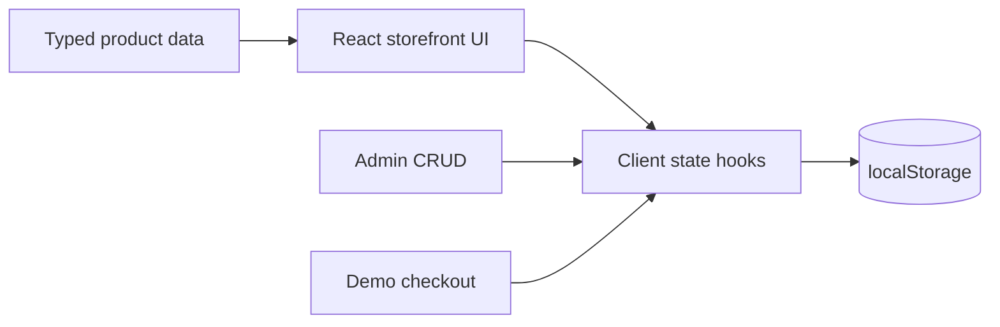

# NovaCart Pro

NovaCart Pro is a polished e-commerce capstone demo built with Next.js, React, TypeScript, and Tailwind CSS. It includes a 60-product catalog, storefront browsing, cart, wishlist, simulated authentication, checkout demonstration, order history, and product CRUD.

## Features

- 60 unique products across six categories
- Search, category filtering, sorting, product details, wishlist, and stock-aware cart
- Admin product create, read, update, and delete workflow
- Simulated account session with no password storage
- Demo checkout and persistent demo order history
- Responsive, keyboard-friendly interface with fallback product images
- localStorage persistence with safe defaults

## Stack

Next.js 16 App Router, React 19, TypeScript, Tailwind CSS v4, Lucide React, and browser localStorage.

## Architecture



## Structure

- `app/page.tsx` — interactive storefront, admin, checkout, and order views
- `app/layout.tsx` — metadata and root layout
- `app/globals.css` — Tailwind theme and base styles
- `lib/products.ts` — typed catalog data, categories, and image sources

## Local setup

```bash
pnpm install
pnpm dev
```

Open `http://localhost:3000`. To verify a production build:

```bash
pnpm build
pnpm start
```

## Demo workflows

Use **Shop** to search and filter products. Product cards open detail views and can be added to the bag or wishlist. The **Admin** view supports validated product creation, editing, and deletion; changes are immediately reflected in the storefront and survive refresh. Checkout creates a demo order number without collecting payment details.

Authentication is intentionally simulated: enter any name and email to create a demo session. No passwords are collected or saved.

## Deployment

Import the project into Vercel or connect the repository, keep the default Next.js build settings, and deploy. No environment variables are required.

## Limitations and security

This is a front-end demonstration. localStorage is not a secure database, client-side admin visibility is not authorization, product images use remote Unsplash URLs, and checkout does not process payment or fulfill orders. A production version should use secure server authentication, a database, server-side validation, protected admin routes, image storage, payment processing, and transactional order handling.

## Screenshots

### Homepage


### Product Catalog


### Admin Dashboard


## Future improvements

- Add a real database and server actions
- Add secure authentication and roles
- Add payment provider integration and inventory transactions
- Add image upload and CDN-backed product media
- Add automated tests and analytics
